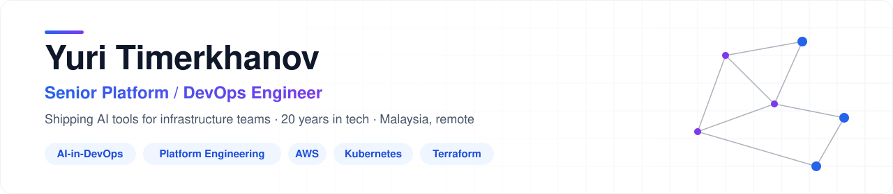
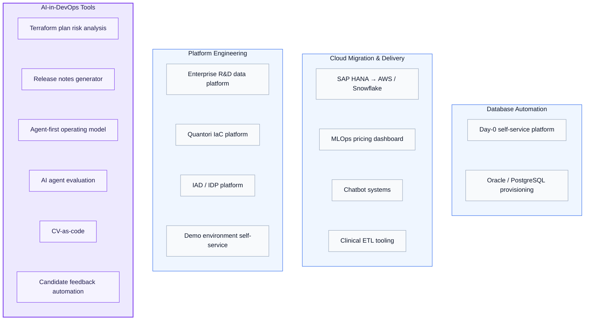
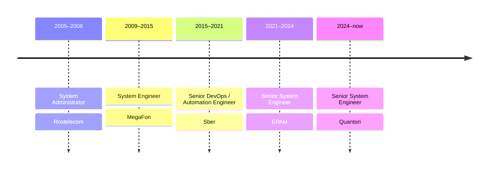

<picture>
  <source media="(prefers-color-scheme: dark)" srcset="assets/banner-dark.svg">
  
</picture>

# Yuri Timerkhanov — Senior Platform / DevOps Engineer

  
  
  
  

**AI-assisted DevOps workflows · Internal Developer Platforms · AWS · Kubernetes · Terraform**

📍 Malaysia &nbsp;·&nbsp; ✉️ [yutimer@gmail.com](mailto:yutimer@gmail.com) &nbsp;·&nbsp; [LinkedIn](https://linkedin.com/in/ytimerkhanov) &nbsp;·&nbsp; [GitHub](https://github.com/yurictl)

> [!TIP]
> **Open to senior Platform Engineer, DevOps, and SRE roles** — remote, contract, or full-time.

---

## Fast Scan

| Signal | Evidence |
|--------|----------|
| **Senior infrastructure depth** | 20 years in tech, 9 years in DevOps, 8 years with AWS, former Oracle DBA with deep SQL tuning background |
| **AI-in-DevOps differentiator** | Built AI tools for Terraform plan review, release-note generation, CV processing, interview feedback, and agent-first documentation workflows |
| **Platform engineering range** | Internal Developer Platforms, self-service provisioning, multi-repo IaC platforms, Kubernetes delivery, observability, FinOps, CI/CD standardization |
| **Current positioning** | Designs operating models where engineers and AI agents can work safely from repo-readable documentation, validated workflows, and CLI-driven automation |

## Strongest Proof Points

| Result | Proof point | What changed | Case study |
|:------:|-------------|--------------|------------|
| **−87%** | **AI Terraform review** | Review time 15 min → 2 min; senior escalations −40%; error diagnosis time −60% | [TerraGuide AI](projects/terraGuide-ai.md) |
| **−95%** | **AI release documentation** | Deployment guide creation 2–4 hours → 5–10 minutes; error rate ~10–15% → under 2% | [AI Release Notes Generator](projects/ai-release-notes.md) |
| **2 wk → 2 h** | **Bank-scale self-service automation** | Database environment provisioning across 3,000+ databases | [Day-0 Self-Service Platform](projects/day-0-self-service-platform.md) |
| **200+** | **Cloud migration under delivery pressure** | AWS resources imported without drift; infra code coverage 70% → 95%; deployments 4x faster | [SAP HANA to AWS / Snowflake](projects/sap-hana-snowflake-migration.md) |
| **30+** | **IaC and database platform standardization** | Terraform modules standardized; development time 2–3x faster; database provisioning overhead −40% | [Quantori IaC Platform](projects/quantori-iac-platform.md) |
| **3** | **Agent-first platform work** | Workspaces on one agent-first operating model; 28 structured documents on the primary platform indexed and mechanically validated | [Agent-First Operating Model](projects/agent-first-operating-model.md) |
| **7** | **AI agent evaluation** | Hackathon submissions reviewed with an agent-assisted, two-pass repository workflow across 6 public-data challenge cards | [AI Hackathon Governance](projects/quantori-ai-hackathon-2026.md) |
| **2** | **Enterprise shared platform reuse** | Greenfield projects reuse the same documentation, tooling, and Makefile framework across different AWS accounts and teams | [Enterprise R&D Data Platform](projects/shared-platform-reuse-dx.md) |

## Portfolio Map

## AI & Automation Projects

| Project | Focus | Key stack | |
|---------|-------|-----------|:-:|
| **Agent-First Operating Model** | Repo-readable documentation, agent onboarding, tool registries, custom AI workflows | Claude Code, Python, Make, CLI skills | [Read](projects/agent-first-operating-model.md) |
| **TerraGuide AI** | Terraform plan risk analysis and failed-apply diagnosis | Python, GPT-4o / GPT-4o-mini, Docker | [Read](projects/terraGuide-ai.md) |
| **AI Release Notes Generator** | Terraform module deployment guide generation | Python, Azure OpenAI, Vault, Confluence API | [Read](projects/ai-release-notes.md) |
| **AI Hackathon Governance** | Public-data challenge design, multi-agent evaluation, repository-level judging | LiteLLM, Claude, Gemini, coding agents | [Read](projects/quantori-ai-hackathon-2026.md) |
| **CV-as-a-Code** | Resume data pipeline and role tailoring | Claude Code, Python, RenderCV, Typst | [Read](projects/cv-as-a-code.md) |
| **Candidate Feedback Tool** | Structured post-interview feedback generation | Claude Code, internal tooling | [Read](projects/candidate-feedback-tool.md) |

## Infrastructure & Platform Projects

| Project | Focus | Key stack | |
|---------|-------|-----------|:-:|
| **Enterprise R&D Data Platform** | Fast greenfield delivery on shared corporate AWS/EKS infrastructure | EKS, Argo Workflows, ArgoCD, Terraform | [Read](projects/shared-platform-reuse-dx.md) |
| **Quantori IaC Platform** | Terraform module testing, database provisioning, CI/CD standardization | Terraform, Terratest, Checkov, GitHub Actions | [Read](projects/quantori-iac-platform.md) |
| **IAD / IDP Platform** | FinOps and monitoring migration on a large internal developer platform | Terragrunt, EKS, AKS, Vault, Prometheus | [Read](projects/iad-framework.md) |
| **SAP HANA to AWS / Snowflake Migration** | Cloud migration, Terraform rewrite, CI/CD migration | Terraform, ECS, Aurora DB, Snowflake | [Read](projects/sap-hana-snowflake-migration.md) |
| **Booking System for Demo Environments** | Company-wide self-service demo environment provisioning | Lambda, ECS Fargate, SQS, DynamoDB | [Read](projects/demo-booking-system.md) |
| **Chatbot Systems** | Stable weekly releases for an internal ML-backed chatbot | Jenkins, Terraform, SageMaker, ECS | [Read](projects/chatbot-systems.md) |
| **ETL & Report Generator** | Clinical data infrastructure and CI/CD from project inception | Terraform, ECS, Glue, Lambda | [Read](projects/etl-report-generator.md) |
| **Price Elasticity Dashboard** | MLOps architecture for a client pilot | Terraform, EKS, Kubeflow, GitHub Actions | [Read](projects/price-elasticity-dashboard.md) |
| **Day-0 Self-Service Platform** | Bank-scale Oracle/PostgreSQL environment automation | Ansible, Jenkins, Python, Oracle | [Read](projects/day-0-self-service-platform.md) |

Full stack for every project is listed at the top of its case study.

## Career Timeline

<b>Exact dates</b>

 

| Period | Role | Company |
|--------|------|---------|
| 11/2024 - present | Senior System Engineer | Quantori |
| 06/2021 - 11/2024 | Senior System Engineer | EPAM |
| 01/2015 - 06/2021 | Senior DevOps / Automation Engineer | Sber |
| 02/2009 - 01/2015 | System Engineer | MegaFon |
| 01/2005 - 12/2008 | System Administrator | Rostelecom |

<b>Skills Snapshot</b>

 

| Domain | Tools & Technologies |
|--------|----------------------|
| **AI & Automation** | OpenAI API, Claude Code, RAG, prompt engineering, AI agents, LLM evaluation, repo-readable operating models |
| **Cloud** | AWS, Azure |
| **Containers** | Docker, Kubernetes, Helm, Kustomize, ArgoCD, EKS, AKS |
| **CI/CD** | GitHub Actions, GitLab CI/CD, Jenkins, Bitbucket, Roadie / Backstage |
| **IaC & Scripting** | Terraform, CloudFormation, Ansible, Python, Bash |
| **IaC Quality** | Terratest, Checkov, CIS Benchmarks, HashiCorp Vault |
| **Observability** | Prometheus, Grafana, OpenTelemetry, CloudWatch, AppDynamics |
| **SRE** | SLIs/SLOs, incident response, zero-downtime releases, FinOps |
| **MLOps** | Kubeflow, MLflow, SageMaker |
| **Databases** | Oracle, PostgreSQL, Aurora DB, DynamoDB, MongoDB, Snowflake |

<b>Credentials</b>

 

- **Certifications:** Certified Kubernetes Administrator (active until Mar 2027), AWS Certified AI Practitioner (active until Oct 2027)
- **Education:** Master's in Mathematics, Ural State University (2000-2006)

<b>Recommendations</b>

 

> **Pavel Konan, CTO, Enginerasoft** 
> Highlighted senior-level cloud infrastructure, automation, AWS migration, DevOps pipeline, mentoring, and knowledge-sharing strengths.

> **Dana Forberger MBA, Associate Director, Global Clinical Data Integration Operations, Merck** 
> Highlighted ownership of an automation tool that reduced a major manual process from approximately six months to about one week.

> **Sergey Samoylov, DevOps Engineer, former Sberbank-Technology** 
> Highlighted critical database support, Oracle cluster work, machine learning environment support, and high-level automation expertise.

