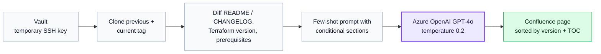

# AI Release Notes Generator — Terraform Module Deployment Guides

- **Company:** EPAM
- **Year / Duration:** 2024
- **Stack:** Python, Azure OpenAI GPT-4o, Docker, BitBucket, Confluence API, HashiCorp Vault
- **Role:** Solo builder — designed, implemented, and shipped

## Problem

Operations teams needed a deployment guide for every Terraform module release — comparing the previous and current version, documenting variable changes, breaking changes, and step-by-step upgrade instructions. Writing one guide manually took 2–4 hours of focused work. With 20–40 releases per month across a large internal developer platform (57 base modules, 293 component modules), this was a constant ops bottleneck. Guides were also inconsistent quality depending on who wrote them.

## What I Did

Built a Dockerized tool that:
1. Clones two versions of a module repository (current and previous tags via temporary SSH keys from HashiCorp Vault)
2. Computes diffs of `README.md` and `CHANGELOG.md` between versions
3. Detects Terraform version changes and extracts module prerequisites
4. Constructs a domain-specific few-shot prompt with a structured output template, then sends it to GPT-4o (temperature 0.2, 128k context window)
5. Formats the result and publishes it directly to Confluence, sorted by version with an auto-generated table of contents

The prompt uses few-shot learning with conditional section logic — sections for secrets, breaking changes, and variable tables only appear when the diff contains relevant content. This prevents hallucination and keeps guides concise.

Secrets are managed entirely through Vault with temporary SSH key rotation — no credentials in code or logs.

## Outcome

- Documentation time reduced 95%: from 2–4 hours to 5–10 minutes per release
- Error rate fell from ~10–15% to under 2%
- Consistency reached 100% — all guides follow the same template structure
- Cost per guide: $0.50–$2 (API) vs. $80–$160 (manual labor)
- Break-even under 1 month from deployment
