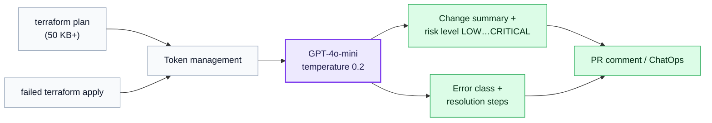

# TerraGuide AI — Terraform Plan Risk Analysis

- **Company:** EPAM
- **Year / Duration:** 2024
- **Stack:** Python, OpenAI GPT-4o / GPT-4o-mini, Docker
- **Role:** Solo builder — designed, implemented, and shipped

## Problem

Terraform plan outputs for large infrastructure platforms can be 50 KB+ of dense HCL. Reviewers would skim or miss destructive changes buried in thousands of lines. Risk assessment was gated on senior engineers, creating a bottleneck — junior engineers couldn't safely approve production changes, and error diagnosis after a failed apply required deep Terraform and AWS knowledge to resolve.

## What I Did

Built a CLI tool that ingests a Terraform plan output, summarizes changes by resource type and category (Add / Modify in-place / Replace / Destroy), assigns a risk level (LOW / MEDIUM / HIGH / CRITICAL), and publishes the result as a PR comment and into ChatOps.

Key technical decisions:
- Used GPT-4o-mini as the default model: 128k context window, 15x cheaper than GPT-4o, with temperature 0.2 for deterministic and safe output
- Built dynamic token management to handle variable plan sizes without hitting API limits
- Added a second analysis mode for failed `terraform apply` outputs — classifies the error type and generates numbered resolution steps
- Packaged as a Docker container with non-root execution, making it CI/CD-ready from day one
- Total implementation: ~240 lines of Python across three decoupled modules (CLI, LLM logic, prompts)

## Outcome

- Plan review time down 87%: from 15 minutes to 2 minutes
- Error diagnosis time cut by 60%: from ~45 minutes to ~18 minutes
- Senior engineer escalations reduced by 40%
- Junior engineers could conduct independent reviews without escalation
- Cost per analysis: under $0.003 (AI) vs. ~$20 (manual labor)
